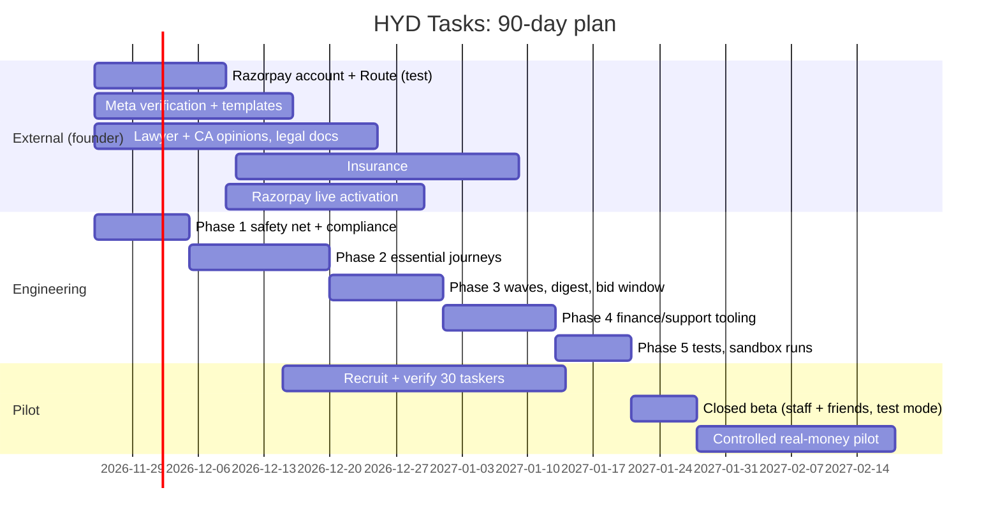

# 90-day launch roadmap (from 24 Nov 2026)

**Assumptions:** one full-time engineer (or Claude Code with a reviewing human), a founder running external approvals in parallel, and part-time ops from week 4.

External approval times are **not under our control**; the dates below are targets, not promises. If an approval slips, the dependent milestone slips with it.

| Weeks | Engineering | Founder / ops | Exit criteria |
|---|---|---|---|
| 1–2 | DEV-01..04 (deploy, backups, monitoring, compliance plumbing, chargebacks, pricing) | Razorpay test account + Route request; Meta business verification; brief lawyer and CA; template submission | Restore drill passed; Razorpay test keys in staging |
| 3–5 | DEV-05..10 (EXTRA, tasker reports, no-show contest, reminders, earnings, photos) | Legal docs drafted; insurance quotes; recruit taskers | Sandbox: full money flow incl. on-hold reversal **proven in Razorpay test mode** |
| 6–7 | DEV-11..15 (waves, conflicts, digest, bid window, opt-in) | Templates approved; permanent token; dedicated number | Simulation S100 shows ≤5 customer bid messages per task |
| 8–9 | DEV-16..20 (digest/recon, support SLAs, business invoice data, admin console, templates) | Support rota; SOPs; drills | Tabletop drills done |
| 10 | DEV-21..23 + full staging plan on real phones in 4 languages | Native-language review | Minimum test set (`TEST_STRATEGY.md` §5) passed |
| 11 | Closed beta in Razorpay test mode: 10 friendly customers, 10 taskers | Go/no-go prep | Beta metrics below |
| 12–13 | Controlled pilot with live money, 3 neighbourhoods | Daily reviews | Expansion metrics (`COMPLETE_PRODUCT_REQUIREMENTS.md` §11) |

## Go/no-go checklist (first real-money transaction)

- [ ] Razorpay **live** account activated; marketplace model approved in writing; Route enabled; on-hold reversal confirmed.
- [ ] Every staging money scenario passed in **test mode** with recorded IDs.
- [ ] Meta: verified business, dedicated number, permanent System User token, all required templates **approved**.
- [ ] Legal: Terms, Privacy, refund/cancellation policy published; grievance officer named; Telangana aggregator obligations and fee handling confirmed; GST/TDS position in writing; insurance active.
- [ ] `npm run check:config` reports no blocking items with `APP_ENV=production`.
- [ ] Backups (hourly, off-site, encrypted) + restore drill within 7 days; uptime monitoring live.
- [ ] Two finance operators with WhatsApp two-step verification; support rota for 8 AM – 9 PM.
- [ ] 30 taskers verified (ID, police, interview) with **activated** linked accounts.
- [ ] P0 and P1 backlog items done; all automated tests green.
- [ ] Founder approves the first transaction plan: one customer, one tasker, small job, finance watching the Razorpay Dashboard.
