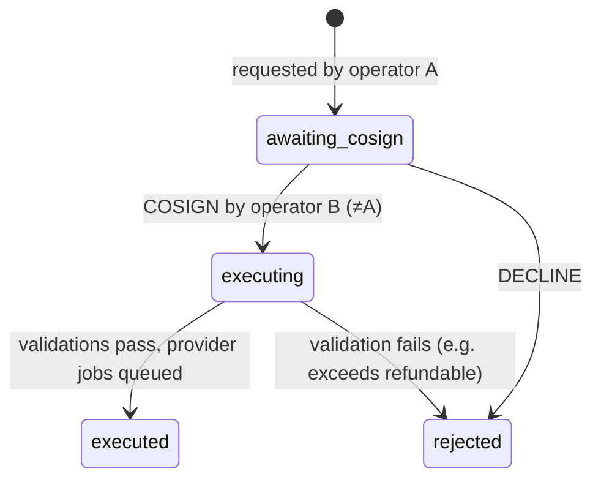

# Administrator workflows

**Current console:** WhatsApp commands from allowlisted numbers, with roles `super`, `support`, `verifier` and `finance` (`config.js:parseAdmins`, `admin.js:COMMANDS`). Every action is written to `audit`. Money movements need a **second operator's co-sign** (`admin.js:financeAction`, `COSIGN`).

Tests: `audit.test.js:395` (role matrix), `journey.test.js:169`, `audit.test.js:97,110,126`.

**Gap:** no web dashboard. WhatsApp commands work for 1–3 operators and fewer than ~30 jobs/day, but are error-prone beyond that.
✳ Build an internal, authenticated, read-mostly web console in phase 4. This is allowed: it's internal infrastructure, not a customer surface.

## A1. Tasker verification — ✅

`PENDING` → `WORKER 91…` → `CHECK 91… identity|police|interview|skills REF` → `LINKACC 91… acc_…` → `APPROVE 91…`.

| Element | Spec |
|---|---|
| Validation | All 3 required checks + linked account (`admin.js:APPROVE`); evidence refs can't look like Aadhaar or PAN |
| Errors | Missing items listed back to the operator |
| Rollback | `REJECT`, `SUSPEND` (withdraws active offers), `REINSTATE` |
| ✳ Add | Re-verification reminders (police verification yearly); a checklist SLA (decision within 72h) |

## A2. Moderation — ✅

`REVIEWQ` → `RELEASE HYD…` (dispatches alerts) or `REJECTJOB HYD… reason`.
✳ Add: a moderation SLA of 30 min in support hours. Outside hours, auto-reply to the customer with the expected time.

## A3. Support tickets — ✅

`TICKETS` → `TICKET n` (thread + relayed chat) → `REPLY` / `REPLYALL` → `CLOSE`.
✳ Add: assignment to an operator, SLA timers, an out-of-hours auto-reply, and canned replies in 4 languages.

## A4. Disputes and refunds — ✅

| Decision | Command | Money effect |
|---|---|---|
| Tasker right | `RESOLVE n release` | Held transfer released |
| Customer right | `RESOLVE n refund` | Full refund; held share reversed; task `refunded` |
| Split / late-cancel fee | `RESOLVE n split X` | X refunded from the held share; the rest released; task completed or cancelled |
| Goodwill | `REFUND HYD… X reason` | Platform-funded; job and payout unchanged |
| Manual payout | `PAYOUT HYD… reason` | Completes and releases |

Every row needs `COSIGN id` from a different finance operator; `DECLINE id reason` rejects it.

## A5. Daily operations — 🟠

- `STATS` gives task and worker counts, failed jobs and failed messages, and payments configuration.
- ✳ Add: a daily 9 AM summary to the founder (bookings, GMV, refunds, disputes, failed jobs, tickets past SLA) and a Razorpay reconciliation report.

## A6. Incidents — documented in `docs/OPERATIONS.md`; ❌ not drilled

✳ Before the pilot, run tabletop drills for:
- a safety incident;
- a leaked key;
- a WhatsApp number restriction;
- a Razorpay outage;
- a database restore.

## A7. Access control

| Risk | Control |
|---|---|
| Operator phone stolen | WhatsApp two-step verification mandatory (policy); remove the number from `ADMIN_PHONES` + restart; co-sign limits the damage |
| Insider fraud | Co-sign ✅, audit ✅, ✳ daily finance digest to the founder |
| Over-privilege | Least-privilege roles ✅ |
