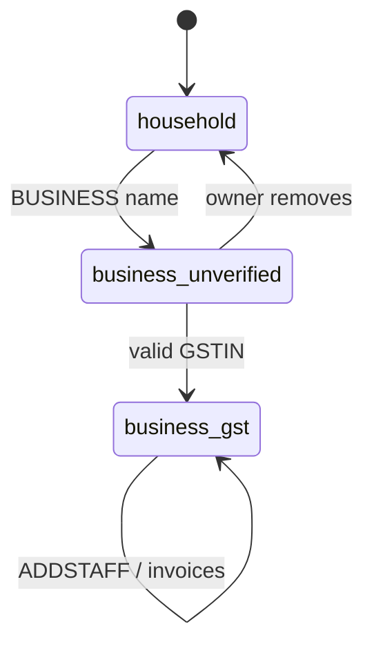

# Business-customer workflows

## Current state (evidence)

- `BUSINESS Company Name` stores `business_name` and applies the business fee rate (`customer.js:business`, `payflow.js:feeRateFor`).
- Everything else is identical to a household customer.
- **Missing:** GSTIN, GST invoices, multiple staff numbers per business, monthly billing, recurring tasks, purchase-order references and multi-worker bookings.

**Design principle:** businesses are the most valuable and most demanding segment. In the pilot, serve them with the household flow plus **GST invoice data**. Defer heavy B2B features until there is demand evidence.

## B1. Business registration — 🟠 → ✳ MVP-B

| Element | Spec |
|---|---|
| Trigger | `BUSINESS` / menu "I'm a business" |
| Dialogue | Business name → GSTIN (optional) → billing address → contact name |
| Validation | GSTIN format check (15 chars, state code 36 for Telangana) + ✳ optional online GSTIN verification through a vendor (phase C) |
| DB | ✳ `businesses` table (id, name, gstin, address, owner_phone); `users.business_id` |
| Notify | Ops: new business (sales follow-up) |
| Errors | Invalid GSTIN → continue as unregistered business (no GST input credit) |
| Security | Only the owner number can add staff numbers |
| End | ✔ Business profile; business fee rate |

## B2. Staff numbers (phase C)

The owner sends `ADDSTAFF 9198…`. The staff member gets a template invite and must reply `AGREE`. Staff can post and pay; only the owner sees all jobs and invoices.

## B3. Business task posting

Same as C2, plus: number of workers (linked bookings, `MATCHING_AND_BIDDING_DESIGN.md` §3.7), an optional PO reference, a recurring option (phase C: "every Saturday 9 AM").

## B4. Payment and invoicing — ✳ P1

- Pilot: pay per booking by Razorpay link.
- ✳ After completion, the platform generates GST invoice data (platform service fee; plus task value if s.9(5) applies, per the CA's position) and sends a PDF link or document.
  WhatsApp supports outbound document messages; generating a PDF is a backend job.
- Phase C: monthly consolidated invoice, pay by NEFT/UPI link, credit limits (credit risk; needs a policy).

## B5. Business disputes

Same as C7, with a priority SLA (first response within 1 business hour).

## B6. State machine (business account)

## Assumptions to validate

- Hyderabad SMBs (cafés, offices, event organisers in Hitech City) will book helpers on WhatsApp instead of through agencies.
- They need GST invoices to justify the spend.
- Monthly billing is a must-have only above about 10 jobs/month.
