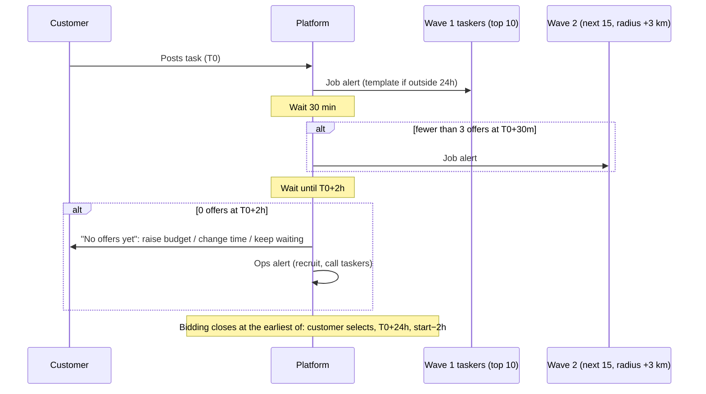
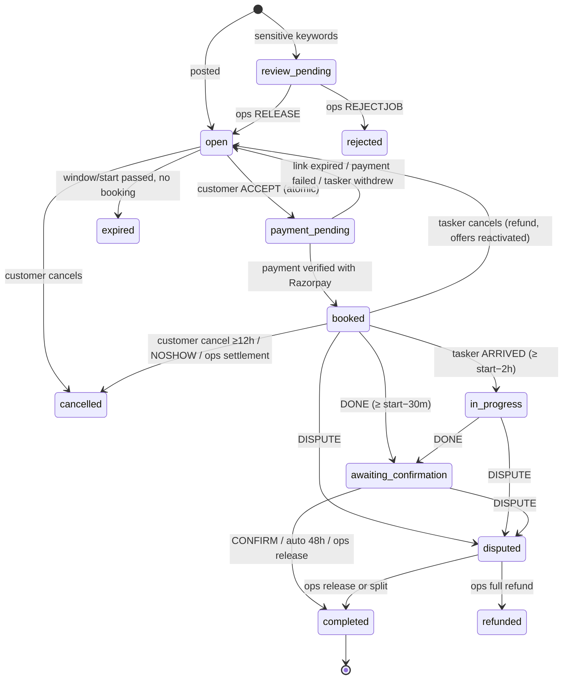

# Task discovery, matching and bidding design

## 1. Current behaviour (evidence)

| Aspect | Today | Evidence |
|---|---|---|
| Eligibility | Approved, opted-in, not blocked, `available=1`, has the skill, task inside the worker's `radius_km` (default 6 km from home-area centroid), fewer than 3 active jobs | `customer.js:eligibleWorkers`, `matching.js:rankWorkersForTask` |
| Ranking | 0.35 proximity + 0.25 Bayesian rating + 0.2 reliability + 0.1 responsiveness + 0.1 load + newcomer boost | `matching.js:24-50` |
| Alerts | **One wave**, top `MATCH_MAX_ALERTS`=15, sent at posting (or at moderator RELEASE) | `customer.js:dispatchTask`; `config.js:80` |
| Pull discovery | `TASKS` lists up to 8 matching open tasks | `worker.js:listTasks` |
| Bidding window | Open until `scheduled_at`, then the task expires | `scheduler.js:sweep` |
| Customer notifications | **One message per offer and per revision** | `worker.js:makeOffer` (`offer_received`) |
| Offer list | Top 10 by price/quality/reliability as a WhatsApp list | `customer.js:status`, `matching.js:rankOffers` |
| Revisions / withdrawal | Unlimited revisions; withdraw allowed | `worker.js:makeOffer` (UPSERT), `withdraw` |
| Busy check | Only the "≥3 active jobs" capacity rule; **no time-overlap check** | `matching.js:33` |
| Selection race | Atomic `open→payment_pending`; second ACCEPT refused | `core.js:transition`; `audit.test.js:214,263` |

**Measured, in-process simulation of the current code** (`TEST_STRATEGY.md` §6):

| Eligible workers | Alerts sent | Bids placed | Customer messages caused by bids |
|---|---|---|---|
| 50 | 15 | 50 | 50 |
| 100 | 15 | 100 | **100** |
| 1,000 | 15 | 100 | **100** |

## 2. Should we use WhatsApp Communities or groups?

**No, not for job distribution.**

- The official Cloud API offers a **Groups API**, which Meta's docs describe as available to businesses with an Official Business Account.
- Developer-community reports and a vendor guide cite a **cap of 8 participants per group**. That figure is *not confirmed in Meta's official page in this research*.
  Sources: [Groups API docs](https://developers.facebook.com/documentation/business-messaging/whatsapp/groups/), [community thread on 8-participant cap](https://developers.facebook.com/community/threads/1084199161066371/), [Unipile guide](https://www.unipile.com/whatsapp-group-api/).
- **Communities** are a consumer and Business **app** feature, with no documented API automation. Automating them would need unofficial tools, which risk a ban.
- Groups also leak every bidder's phone number to the others and the customer, breaking our privacy model.

**Decision:** use one-to-one messages only (private alerts plus the `TASKS` pull). A Community may be used **manually** by ops for tasker announcements and training, never for jobs, payments or customer data.

## 3. Recommended design

### 3.1 Eligibility (hard filters, all must pass)

1. Worker `status='approved'`, opted in, not blocked or erased, linked payout account present.
2. The skill matches the task category.
3. The task is inside the worker's **service radius**: default 5 km, worker-adjustable 2–15 km. Pilot zones are dense, so 5 km covers Gachibowli, Kondapur and Madhapur from each other.
4. **No schedule conflict:** no booked or in-progress job within ±3 h of the task start *(new)*.
5. Below the daily alert cap (§3.4) *(new)*; not in quiet hours unless the task is urgent *(new)*.
6. Not previously blocked by this customer, and not the customer themselves.

### 3.2 Score (soft ranking; configurable weights)

`score = 0.30·proximity + 0.25·rating(Bayesian) + 0.20·reliability + 0.10·responsiveness + 0.10·acceptance_rate + 0.05·newcomer_boost`

- **acceptance_rate:** the share of alerts that led to an offer in the last 30 days *(new)*. It rewards engaged taskers and reduces wasted alerts.
- **Fairness guard:** a tasker who received 0 alerts in the last 48h gets a temporary boost, so newcomers aren't starved.

### 3.3 Notification waves (MVP defaults, all configurable)

| Parameter | Default | Why |
|---|---|---|
| Wave 1 size | 10 | Enough for 3–5 offers at an assumed 30–50% response rate *(assumption to validate)* |
| Wave 2 trigger / size | <3 offers after 30 min / 15 more, radius +3 km | Fill rate without spamming |
| Wave 3 | none automatic; ops alert at 2h with 0 offers | Humans fix liquidity holes in the pilot |
| Max alerts per task | 40 | Cost and spam ceiling |
| Urgent tasks (start <4h) | Wave 1 = 20, wave 2 after 10 min | Speed matters more than cost |
| Bid window | earliest of 24h / start−2h / customer selects | Customer certainty; tasker scheduling |
| Customer can close early | Yes: selecting closes it; `CLOSE HYD0001` closes without booking | |
| Max offers per task | 20 (later bidders told "this job already has many offers") | Customers can't compare 100; protects tasker effort |
| Max revisions per offer | 3, before selection only | Avoids price ping-pong |
| Per-tasker alert cap | 10 per day; quiet hours 21:00–07:00 IST (urgent exempt) | Template cost, WhatsApp quality rating, tasker goodwill |

### 3.4 What the customer sees (bid digest)

| Event | Message |
|---|---|
| 1st offer | Immediate "You have your first offer" with the offer summary + "See offers" button |
| 3rd offer, or 30 min after the 1st | Digest: top 3 offers (price, rating, jobs, distance, badges) + "See all" |
| Later | At most one digest per 2h while open; a final "Bidding closes in 1h" reminder |
| Revisions | Never a separate message; shown in the next digest |

This caps bid-related customer messages at **about 5 per task**, against 100 today for 100 bids.

### 3.5 Offer integrity (fake / duplicate bids)

- One offer per tasker per task (DB `UNIQUE(task_id, worker_phone)`, `db.js`) ✅
- Only verified taskers can bid ✅ (`worker.js:requireApproved`)
- Bounds: ≥ ₹300 *(proposed minimum)* and ≤ 3× budget. Offers below 40% of the budget are flagged to ops (possible bait-and-switch, then an "extra money" request).
- Rate limit per number ✅ (`core.js:rateLimited`); offer notes masked for phone numbers and UPI IDs ✅
- Collusion signals: the same device or customer repeatedly picking the same tasker at inflated prices → ops report (phase C).

### 3.6 Selection, payment and fallback (state machine)

| Situation | Behaviour |
|---|---|
| Customer selects two taskers at once | The first ACCEPT wins (atomic UPDATE … WHERE status='open'); the second gets "not available" ✅ tested |
| Selected tasker becomes unavailable before payment | Tasker `CANCELJOB` → payment link cancelled, offer withdrawn, customer told to pick again ✅ |
| Selected tasker cancels after payment | Full refund, task reopens with other offers reactivated, tasker penalised ✅ |
| Payment fails or isn't completed | Link expires after 60 min (+10 min grace) → task reopens, offer active again ✅ |
| No bids | Wave 2 → 2h customer nudge + ops alert *(new)*; expire at start time ✅ |
| Customer disappears with offers waiting | Reminder at 4h and 12h; auto-close at the window end; taskers told "the customer chose not to book" *(new)* |
| 100 bidders | Capped at 20 offers; extra taskers told politely; digest shows the top 3 and a list of 10 *(new)* |

### 3.7 Multi-worker jobs ("I need 5 people for an event")

**Recommendation (MVP):** create **linked bookings**.
- The customer answers "How many people?" (1–5).
- The task stores `workers_needed`; each accepted offer becomes its own booking, payment line and payout under one customer payment.
- Bidding stays open until all slots are filled.

**MVP shortcut if engineering time is short:** a customer who needs N people posts N tasks (the same text with "1 of 3"). This is clunky but safe.

**Not recommended:** one tasker bringing **unverified helpers** into homes. If the founder wants "team leaders", the helpers must be registered and verified as taskers too.

### 3.8 Configurable parameters

`WAVE1_SIZE`, `WAVE2_DELAY_MIN`, `WAVE2_SIZE`, `WAVE_RADIUS_STEP_KM`, `MAX_ALERTS_PER_TASK`, `MAX_OFFERS_PER_TASK`, `MAX_OFFER_REVISIONS`, `BID_WINDOW_HOURS`, `BID_CLOSE_BEFORE_START_H`, `WORKER_DAILY_ALERT_CAP`, `QUIET_HOURS`, `SCHEDULE_CONFLICT_H`, `DEFAULT_RADIUS_KM`, `MIN_TASK_RUPEES`, ranking weights.

Today, only `MATCH_MAX_ALERTS` exists (`config.js:80`).

## 4. Scaling path

| Scale | Approach |
|---|---|
| Pilot (≤300 taskers, ≤50 tasks/day) | Current in-process ranking is fine: 19 ms at 1,000 taskers in simulation |
| City (≤10k taskers) | Precompute a geohash or zone index; Postgres + PostGIS; separate worker queue for alerts |
| Multi-city | Per-city WhatsApp numbers/WABAs for messaging-limit headroom; regional ops |

## 5. Assumptions to validate in the pilot

- Tasker response rate to alerts (assumed 30–50%).
- Customers want 3–5 offers, not 20.
- 24h is an acceptable bid window for non-urgent jobs.
- 5 km radius is acceptable to taskers using two-wheelers.
- Quiet hours don't hurt urgent demand.
