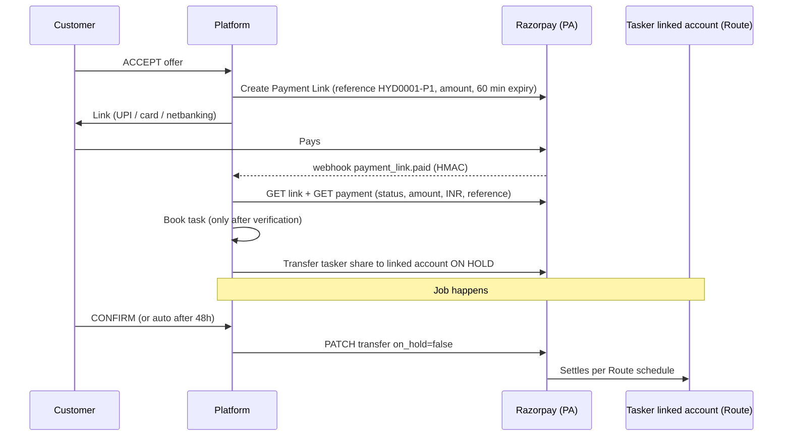

# Payments, compliance and trust

> **Not legal or tax advice.** Statutory points are from secondary sources found on 24 Nov 2026 and must be confirmed by a lawyer and a chartered accountant.

## 1. Money flow (designed and implemented against a test double; 🔒 never run on Razorpay)

**Evidence:**
- `payflow.js:startPayment,markCaptured,requestRefund`
- `service.js` jobs: `payment.create`, `payment.verify_link`, `transfer.create`, `transfer.release`, `refund.execute`
- tests `journey.test.js:5`, `audit.test.js:155,177,199,227,472`

**Controls implemented ✅:**
- Webhooks never change money state by themselves.
- Amount, currency and reference are verified with Razorpay before booking.
- Late and duplicate payments are refunded automatically.
- Check-before-create stops duplicate transfers, reversals and refunds.
- Two-person co-sign for operator refunds and payouts.
- A refund can never exceed the amount captured.
- Payouts are released only for completed jobs (or approved cancellation fees).

**Open technical items:**

| Item | Status |
|---|---|
| Reversal of an **on-hold** transfer | Not documented publicly. **Must be confirmed with Razorpay** before launch ([Route reversal docs](https://razorpay.com/docs/payments/route/reversal.md)) |
| Payout timing after release | Follows the Route settlement schedule. Tasker expectations need setting (Airtasker publicly states 3–5 business days) |
| Chargebacks / payment disputes raised by the customer's bank | ❌ Not handled. Need webhook handling (`payment.dispute.*`), a hold on the related transfer, and an ops workflow |
| Reconciliation report (daily Razorpay settlement vs our ledger) | ❌ |
| Ledger | 🟠 Only `payments` / `transfers` / `refunds` tables; no double-entry ledger. Acceptable for the pilot; add a ledger before scale |

**Never:** hold customer money in the founder's or company's bank account and "pay workers later". Never mark a booking paid because a user sent a screenshot or a WhatsApp message.

## 2. Pricing and unit economics (current code vs recommendation)

| Component | Current code (`payflow.js:startPayment`, `matching.js:priceBreakdown`) | Recommendation |
|---|---|---|
| Customer service fee | 18% household / 15% business | 15% / 12%, minimum ₹49 *(decision)* |
| GST | 18% on the fee only (`FEE_GST_RATE`) | Depends on the CA's position on **CGST s.9(5)**: notified services such as housekeeping supplied through an e-commerce operator by unregistered suppliers make the operator liable for GST. If it applies, GST is due on the **service value**, not only the fee |
| Tasker fee | none | none in the pilot (supply acquisition) |
| Telangana welfare fund fee | **not modelled** | Up to **2% of each eligible payout**, paid by the platform, **not deducted from the worker** (rules notified 14 Nov 2026, per [TeamLease RegTech](https://teamleaseregtech.com/updates/article/61358/telangana-platform-based-gig-workers-registration-social-security-and-/) and [PRS](https://prsindia.org/files/bills_acts/acts_states/telangana/2026/Act21of2026TG.pdf)) |
| Central SS Code aggregator contribution | **not modelled** | 1–2% of turnover, capped at 5% of payouts to gig workers, **if notified for our aggregator category** ([PIB](https://pib.gov.in/PressReleasePage.aspx?PRID=2200767)) |
| Minimum task | ₹100 | ₹300 |

**Illustrative unit economics for one ₹800 job** (assumptions, to validate):

| Line | ₹ |
|---|---|
| Service fee 15% | +120 |
| Payment processing (assume ~2% of ₹920 total) | −18 |
| Telangana welfare fee (2% × ₹800) | −16 |
| WhatsApp messages | −5 |
| Support + ops (pilot staffing spread over volume) | −40 to −80 |
| Refund / fraud / goodwill reserve (3%) | −4 |
| **Contribution** | **+37 to −3** |

The pilot will not be profitable per job. That's acceptable if the founder treats it as learning spend. Profitability needs higher average order value, repeat use and lower support cost per job.

## 3. Compliance register

| # | Obligation | Source (verify) | Status | Owner |
|---|---|---|---|---|
| 1 | Entity, PAN/TAN, bank, GST registration | GST law (CA) | 🔒 | Founder + CA |
| 2 | GST s.9(5) / s.52 TCS position and GST-compliant invoices | CGST Act (CA) | ❌ no invoice generation | CA → engineering |
| 3 | Income-tax **s.194-O** TDS on payouts to taskers | Income Tax Act (CA) | ❌ | CA → Razorpay → engineering |
| 4 | **Telangana Platform Based Gig Workers Act 2026** (Act 21 of 2026; reported in force 2 Jun 2026; rules notified 14 Nov 2026): register as aggregator, **submit the worker database in machine-readable form and update it quarterly**, pay the welfare fund fee ≤2% of payouts | [PRS Act PDF](https://prsindia.org/files/bills_acts/acts_states/telangana/2026/Act21of2026TG.pdf), TeamLease RegTech | ❌ **P0** | Lawyer → engineering (export + fee) |
| 5 | **Code on Social Security 2020** aggregator duties (in force 21 Nov 2025, per news) | [PIB](https://pib.gov.in/PressReleasePage.aspx?PRID=2200767), [Business Standard](https://www.business-standard.com/amp/industry/news/gig-workers-welfare-aggregators-turnover-contribution-125112101188_1.html) | ❌ | Lawyer |
| 6 | **DPDP Act 2023 + Rules**: notice, consent, grievance officer, retention, breach process | DPDP | 🟠 consent + erasure in code; no published notice | Lawyer |
| 7 | **Consumer Protection (E-Commerce) Rules 2020**: grievance officer, price display, refund policy, seller (tasker) details | MeitY/DoCA | 🟠 price shown before payment; rest missing | Lawyer |
| 8 | IT Act intermediary due diligence | IT Rules 2021 | 🔒 | Lawyer |
| 9 | Payment aggregator use | RBI PA guidelines via Razorpay | 🔒 Razorpay must approve the marketplace model; we never hold funds | Founder |
| 10 | Tasker verification (police verification process, ID check outside WhatsApp) | Local police procedures | 🟠 `CHECK` records evidence references | Ops |
| 11 | Insurance (accident cover for taskers, liability for property damage) | Insurer | ❌ | Founder |
| 12 | Shops & Establishments (Telangana) | State law | 🔒 | Founder |

## 4. Worker identity and verification

- **Implemented:** identity, police and interview checks are recorded with an evidence reference, plus a payout account (Route). Approval is blocked without them. Aadhaar/PAN-like numbers are refused in the evidence field (`admin.js:CHECK`, `APPROVE`).
- **Recommended:**
  - DigiLocker-based ID verification through a licensed KYC vendor (phase C).
  - A re-verification cadence (police verification yearly).
  - A face-match selfie at first job (phase C).
- **Never** collect Aadhaar numbers or ID photos over WhatsApp chat.

## 5. Safety

| Risk | Control (status) |
|---|---|
| Unsafe or illegal task | Keyword moderation queue ✅ (`parse.js:reviewReason`); category whitelist (decision) |
| Tasker safety at a customer's home | ❌ Safety check-in for jobs >3h; `SOS` keyword → immediate ops call + 112 guidance; ability to refuse unsafe sites without penalty (`UNSAFE HYD…`) |
| Customer safety | Verified taskers ✅; masked numbers ✅; option to request a female tasker (decision; needs supply) |
| Harassment in chat | Relay logs kept 180 days ✅ (`scheduler.js:RETENTION`); BLOCK ✅ |

## 6. Fraud register (payments)

| Fraud | Control |
|---|---|
| Fake payment screenshot | Never accepted; only Razorpay verification books ✅ |
| Webhook spoofing | HMAC + server-side lookup ✅ |
| Tasker marks done early to trigger auto-confirm | DONE time guard + 48h confirm window ✅ |
| Customer falsely claims no-show | 🟠 Auto-refund today. Recommend: the tasker gets 30 min to contest with a location pin before the refund executes |
| Customer chargeback after confirmation | ❌ Needs handling (§1) |
| Bait-low-then-extra-cash | ❌ Needs an in-platform price increase + offer floor flagging |
| Operator insider refund to self | Two-person co-sign ✅ + audit ✅; recommend a daily finance report to the founder |
