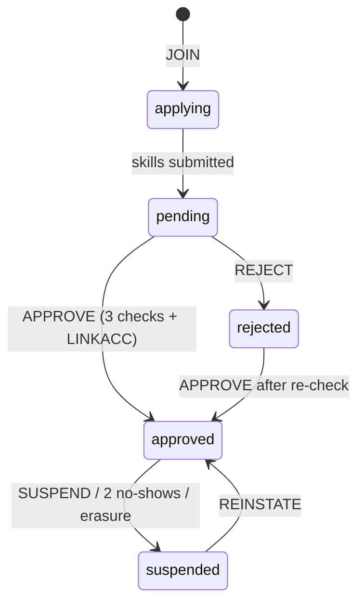

# Tasker workflows

The conventions are the same as in `CUSTOMER_WORKFLOWS.md`.

## T1. Apply and get verified
**Status:** ✅ `worker.js:startJoin,continueJoin`; `admin.js:CHECK,LINKACC,APPROVE`; tests `conversations.test.js:95`, `audit.test.js:449`

| Element | Spec |
|---|---|
| 1 Trigger | `JOIN` / "Become a tasker" |
| 2–4 Dialogue | Full name → home area or 📍 → skills (numbers) → "PENDING". ✳ Add: service radius, languages spoken, two-wheeler yes/no, explicit job-alert consent |
| 5 Validation | Name 2–80 chars with no long digit runs; known area; ≥1 skill |
| 6 DB | `worker_profiles` `applying` → `pending`; `users.role='worker'`; audit |
| 7 Notify | Verifier ops: application summary |
| 8 Timeout | ✳ The applicant gets a status update if still pending after 72h |
| 9 Errors | Re-JOIN while pending, approved or suspended is refused with the current status ✅ |
| 10 Rollback | Ops `REJECT` with a reason |
| 11 Security | ID numbers and photos are never collected in chat. Verification happens offline; only evidence references are stored; Aadhaar/PAN-like strings are refused ✅ |
| 12 End | ✔ `approved` (identity + police + interview + Route linked account) · ✘ `rejected` |

## T2. Availability and discovery
**Status:** 🟠 `worker.js:setAvailability,listTasks`; alerts via `customer.js:dispatchTask` (single wave)

| Element | Spec |
|---|---|
| Trigger | `AVAILABLE` / `UNAVAILABLE`; job alert; `TASKS` |
| Presented | Alert: id, category, area + distance, description, time, budget, how to bid. ✳ Buttons: "Make offer" (opens a Flow or asks for a price), "Not interested" (feeds acceptance rate) |
| Validation | Only approved taskers see tasks or bid; radius and skill filter ✅; ✳ schedule-conflict filter; ✳ daily alert cap; ✳ quiet hours |
| Errors | Alert outside 24h with no template → held until the tasker writes (✳ templates are a P0) |
| End | ✔ Offer made (T3) |

## T3. Make, revise and withdraw offers
**Status:** ✅ `worker.js:makeOffer,withdraw`; ✳ revision cap, offer cap, floor flagging

| Element | Spec |
|---|---|
| 1 Trigger | `OFFER HYD0001 750 note` |
| 5 Validation | Approved; task open and within radius/skill; amount ≥ minimum; one offer per tasker (UPSERT); notes masked |
| 6 DB | `offers` active; audit |
| 7 Notify | Customer digest (✳; today one message per bid) |
| 9 Errors | Task closed or full → "not available"; suspended → told |
| 10 Rollback | `WITHDRAW` before selection; after selection = cancellation (T6) |
| 12 End | ✔ selected → "wait for BOOKED" · ✘ another tasker booked → told |

## T4. Booked job: arrival, chat, completion
**Status:** ✅ `worker.js:arrived,done`, `support.js:relay`; tests `audit.test.js:18,36`

| Element | Spec |
|---|---|
| 3 Presented | BOOKED card: description, area, time, earning, ARRIVED/DONE instructions; the address arrives via ADDRESS |
| 5 Validation | ARRIVED from start−2h; DONE from start−30m; only the assigned tasker |
| 6 DB | `in_progress` → `awaiting_confirmation` (auto-confirm at +48h) |
| 7 Notify | Customer: arrival, completion request with buttons |
| 8 Timeout | Booked but no DONE 12h after start → ops alert ✅; ✳ day-before confirmation ("Reply YES to confirm you're coming"), and no reply in 3h → ops + backup tasker |
| 9 Errors | ✳ Customer absent → `CUSTNOSHOW HYD…` with a location pin → ops ticket → cancellation fee to the tasker (missing today); ✳ unsafe site → `UNSAFE HYD…` → leave, no penalty, ops call |
| 12 End | ✔ `completed` → payout released · ✘ dispute |

## T5. Scope change / price increase ❌ (P1)
✳ `EXTRA HYD0001 300 reason` → customer gets an Approve/Decline card → on approval, a new Razorpay link for the extra amount + fee → captured → added to the on-hold transfer (a second Route transfer). Decline → the job continues at the original price, or either party opens a dispute. Cap: 2 requests, total ≤100% of the original quote. **This removes the main reason for cash side-payments.**

## T6. Tasker cancellation
**Status:** ✅ `customer.js:workerCancel` (via `CANCELJOB`); test `journey.test.js:151`

- Before payment: the offer is withdrawn and the customer is told.
- After payment: full refund, the task reopens with other offers reactivated, `jobs_cancelled+1`, ops alerted.
- ✳ Escalating penalties: a warning, then a ranking penalty, then suspension after 3 cancellations in 30 days.

## T7. Payout and earnings
**Status:** 🟠 release ✅ (`service.js:'transfer.release'`); ❌ earnings summary; ❌ payout failure guidance for the tasker

- ✳ `EARNINGS`: this week's / month's completed jobs, released amounts and pending (on hold) amounts, with Razorpay transfer references.
- ✳ If the linked account is suspended or KYC fails: a message to the tasker with fix steps, plus an ops ticket.

## T8. Reviews
**Status:** ✅ the tasker can rate the customer (`support.js:rate`). ✳ Customer ratings should feed tasker-side warnings (for example a customer with repeated disputes).

## T9. Profile management ❌ (P2)
✳ `PROFILE` shows the profile. `EDIT AREA` / `EDIT SKILLS` / `EDIT RADIUS`. Adding a new skill category that needs verification (for example cleaning to assembly) goes back to ops review.
