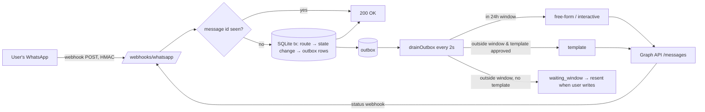

# WhatsApp Business Platform architecture

## 1. Feasibility summary

| Capability | Official support (as researched 24 Nov 2026) | Our status | Notes |
|---|---|---|---|
| 1:1 user-initiated conversations | Yes (Cloud API) | ✅ `server.js`, `core.js` | Free-form replies allowed within the **24-hour customer-service window** |
| Business-initiated messages | Only **approved templates** | Logic ✅ `whatsapp.js:drainOutbox`; 🔒 no templates approved | Job alerts, offer/booking/payment notices outside 24h |
| Interactive reply buttons (≤3) / lists (≤10 rows) | Yes | ✅ payload; 🔒 real-device rendering unverified | Titles truncated to 20/24 chars (`whatsapp.js:buildRequest`) |
| WhatsApp **Flows** (forms) | Yes: interactive inside the window; template with FLOW button outside it, after approval ([Meta](https://developers.facebook.com/documentation/business-messaging/whatsapp/flows/guides/sendingaflow), [Infobip](https://infobip.com/docs/whatsapp/whatsapp-flows)) | ❌ | Good fit for posting, tasker application and dispute forms (phase 2) |
| Location pins (inbound) | Yes | ✅ `whatsapp.js:parseWebhook`, `areas.js:nearestArea` | |
| Media (photos, voice) inbound | Yes: media ID in webhook → GET URL (expires ~5 min) → download with token; media available **7 days** ([Meta media docs](https://developers.facebook.com/documentation/business-messaging/whatsapp/business-phone-numbers/media)) | ❌ rejected politely | Photos: phase 2. Voice: needs speech-to-text with Telugu/Hindi support (vendor TBD) |
| Groups | Groups API on Cloud API; cap **reportedly 8 participants** (unconfirmed) ([docs](https://developers.facebook.com/documentation/business-messaging/whatsapp/groups/)) | Not used | Unsuitable for job distribution; see `MATCHING_AND_BIDDING_DESIGN.md` §2 |
| Communities | App feature; **no API automation found** | Not used | Manual ops announcements only |
| WhatsApp Pay (India) | Yes, with a payment configuration linked to a PG and Meta approval | Coded, off (`whatsapp.js` `order_details`) 🔒 | Re-test against the approved configuration |
| Delivery / read receipts | Yes (status webhooks) | 🟠 failures recorded (`whatsapp.js:recordDeliveryStatus`); delivered/read not used | Use "delivered" to count real alert reach (phase 2) |

## 2. Message architecture

- **Idempotency:** message IDs are stored in `inbound_events`. A failed processing rolls back and returns 500 so that Meta redelivers (`server.js`).
- **Retries:** 429/5xx use exponential backoff, up to 8 attempts. 4xx is permanent, except error 131047, which waits for the window to reopen (`whatsapp.js`).
- **Session management:** `sessions` table, one active conversation step per user, purged after 2 days (`scheduler.js`).

## 3. Templates

| Key | Category (requested) | Purpose | Status |
|---|---|---|---|
| `job_alert` | Utility | New matching job for an opted-in tasker | Text drafted (`docs/WHATSAPP_TEMPLATES.md`); 🔒 not submitted |
| `offer_received` | Utility | New offers digest | 🔒 (text needs a digest wording change) |
| `payment_request` | Utility | Pay reminder | 🔒 |
| `booking_confirmed` | Utility | Booking + time | 🔒 |
| `completion_request` | Utility | Confirm or report a problem | 🔒 |
| `generic_update` | Utility | Fallback; Meta may reject because it is mostly variable | 🔒, likely to be split into specific templates |
| **Needed additions** | Utility | `job_reminder_day_before`, `bidding_closing`, `refund_processed`, `payout_released`, `support_reply`, `tasker_approved` | ❌ |

**Template risk:** Meta decides the category. Job alerts could be classed as **marketing**, which costs roughly 6–8× more and has stricter opt-in rules. Keep the wording strictly transactional and tied to the tasker's opted-in availability.

## 4. Opt-in and opt-out

- **Customers:** the first inbound message plus `AGREE` records consent and the terms version (`core.js:route`).
- **Taskers:** `JOIN` plus `AVAILABLE` is an explicit opt-in to job alerts. `UNAVAILABLE` pauses alerts; `STOP` stops all messages (`core.js:route`).
- **Gap:** the opt-in record for *job alerts* should be explicit wording ("I agree to receive job alerts on WhatsApp"), stored with a timestamp, for Meta policy evidence.

## 5. Messaging costs (estimates; verify against Meta's official rate card)

- Meta moved to **per-message pricing on 1 Jul 2025**.
- Reported India rates conflict:
  - ₹0.115 utility / ₹0.8631 marketing (one set);
  - ₹0.145 / ₹1.09 from 1 Oct 2026 (another).
- One source says utility messages inside the service window became chargeable in Oct 2026. **Unverified.**
- Sources: [Meta pricing](https://developers.facebook.com/documentation/business-messaging/whatsapp/pricing), [AiSensy](https://m.aisensy.com/blog/whatsapp-per-message-pricing-update-effective-january-1-2026/), [Cashify](https://www.cashify.in/news/business-whatsapp-messages-price-revised-in-india-new-rates-explained).

| Per booked task (estimate) | Count | Cost at ₹0.145 utility |
|---|---|---|
| Job alerts (templates) | 10–25 | ₹1.5–3.6 |
| Customer templates (digest, payment, booking, completion) | 3–5 | ₹0.4–0.7 |
| Tasker templates (selected, booked, payout) | 2–3 | ₹0.3–0.4 |
| In-window replies | ~30 | ₹0 (or up to ₹4 if in-window utility becomes chargeable) |
| **Total** | | **≈ ₹2–9 per booked task** |

Tasks that are posted but never booked still cost the alert messages, so **fill rate drives cost**.

## 6. Account health and limits

- New numbers start with **messaging limits** on unique business-initiated recipients per 24h, which rise with quality. This caps wave sizes early on: **monitor the tier in WhatsApp Manager**.
- Quality rating drops when users block or report. Mitigations: digests, quiet hours, alert caps, easy `UNAVAILABLE`/`STOP`.
- **Single number = single point of failure.** Keep a verified backup number and a documented re-onboarding plan. Never use unofficial automation tools.

## 7. Human escalation

- `HELP` creates a ticket; operators reply with `REPLY`/`REPLYALL` from their own WhatsApp (`admin.js`).
- **Gap:** out-of-hours auto-reply with the response time and emergency guidance. A shared team inbox (internal web dashboard) is recommended once there are more than 2 operators.

## 8. Features that need approvals or workarounds

| Feature | Needs |
|---|---|
| Any business-initiated message | Approved templates |
| Display name, higher limits | Business verification, display-name approval |
| WhatsApp Pay | Meta payment configuration + PG (Razorpay) + terms acceptance |
| Flows outside the window | Approved template with a FLOW button |
| Voice transcription | Third-party speech-to-text vendor with Telugu support; DPDP consent for audio processing |
